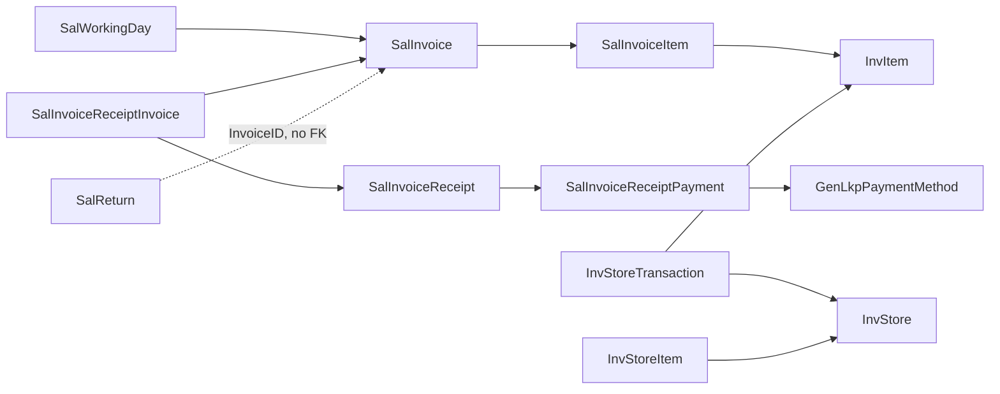

# Screen and Database Relationship Knowledge Base

## 1. Purpose
Reusable project knowledge of how MacOne (MAC1) and portal screens, UI fields, business workflows and SQL Server tables are connected. Read it before investigating any new Story, and re-validate the entries that Story touches.

## 2. Rules
1. Only Verified relationships are project knowledge. Verified means confirmed by database metadata (sys.foreign_keys, key columns), real records and application behavior together.
2. Never infer a relationship from similar column names alone.
3. Partially Verified, Assumed and Unknown items go in section 5 until confirmed; never treated as facts.
4. Every entry names its evidence: SQL query reference (file and query number) and screenshot folder.
5. When a later Story contradicts an entry, mark it "Needs re-check" with the date and Story, then fix or remove it after verification.
6. Each entry records the build it was last verified on.

## 3. Verified relationships

| # | Screen | UI field or action | Table.Column | Related table.column | Relationship type | Expected DB behavior | Verification result | SQL ref | Story | Build | Last verified |
|---|---|---|---|---|---|---|---|---|---|---|---|
| 1 | POS Dashboard, Overview | Daily Sales, Net Sales, VAT, Invoices | SalInvoice.BranchID, InvoiceTotalAmount, InvoiceBeforeTaxAmount, InvoiceTaxAmount | GenBranch.ID (FK_SalInvoice_GenBranch); SalReturn.BranchID (FK_SalReturn_GenBranch) | Many to one | Sales of the day = invoices of the branch minus returns of the branch | Matched UI, TC-005 runs 73 and 74 | Index 1, 31 | 214 | 1.2.498 | 2026-11-20 |
| 2 | POS Dashboard, Payments | Received and refunded per payment method | SalInvoiceReceiptPayment.InvoiceReceiptID, PaymentMethodID; SalReturnReceiptPayment.ReturnReceiptID, PaymentMethodID | SalInvoiceReceipt.ID, SalReturnReceipt.ID, GenLkpPaymentMethod.ID (FKs) | Many to one | Each payment line belongs to one receipt and one method | Matched UI, run 74 | Index 3, 31 | 214 | 1.2.498 | 2026-11-20 |
| 3 | POS Dashboard, Register | Opening cash, invoices of the working day | SalInvoice.WorkingDayID | SalWorkingDay.ID (FK_SalInvoice_SalWorkingDay); SalReturn and SalWorkOrder also have WorkingDayID FKs | Many to one | Every invoice belongs to one working day; opening cash is SalWorkingDay.OpenBalanceCashAmount | Matched UI, run 74 | Index 4, 31 | 214 | 1.2.498 | 2026-11-20 |
| 4 | POS Dashboard, Top Selling | Item, quantity, sold value | SalInvoiceItem.InvoiceID, ItemID | SalInvoice.ID, InvItem.ID (FKs) | Many to one | Top Selling = invoice lines of the branch grouped by item | Matched UI, run 74 | Index 8, 31 | 214 | 1.2.498 | 2026-11-20 |
| 5 | POS Dashboard, Work Orders | Count per status, distinct customers | SalWorkOrder.DocumentStatusID, CustomerID | GenLkpDocumentStatus.ID, SalCustomer.ID (FKs) | Many to one | Pending = New, Completed = Submitted, Voided = Cancelled | Matched UI, run 74 | Index 21, 29, 31 | 214 | 1.2.498 | 2026-11-20 |
| 6 | POS Dashboard, invoice list | Paid amount per invoice | SalInvoiceReceiptInvoice.InvoiceReceiptID, InvoiceID | SalInvoiceReceipt.ID, SalInvoice.ID (FKs) | Junction, many to many (receipt to invoice) | Payments reach an invoice only through this table; 346 of 346 receipts linked | Matched UI, run 74 | Index 26, 31, 35 | 214 | 1.2.498 | 2026-11-20 |
| 7 | POS Dashboard, returns | Return with its original invoice | SalReturn.InvoiceID | SalInvoice.ID (no FK constraint; logical link) | Many to one | 38 of 38 returns resolve to an invoice, none null | Matched UI, run 74 | Index 27, 32 | 214 | 1.2.498 | 2026-11-20 |
| 8 | POS Dashboard, Inventory grid | Quantity, Min, Max per store | InvStoreTransaction.StoreID, ItemID, BaseItemQuantity; InvStoreItem.ItemMinQuantity, ItemMaxQuantity | InvStore.ID, InvItem.ID (FKs on both tables) | Many to one; InvStoreItem one row per store and item | Qty = sum of base qty of store transactions; min and max from InvStoreItem | Matched UI, run 74 | Index 30, 31 | 214 | 1.2.498 | 2026-11-20 |
| 9 | POS Dashboard, Gross Profit | COGS today | InvStoreTransaction.BaseItemQuantity x ItemCost, DocumentTypeID | GenLkpDocumentType.ID (FK) | Many to one | COGS = base qty x cost of the day's sale and return transactions | 792.00 matched UI, run 74 | Index 23 | 214 | 1.2.498 | 2026-11-20 |
| 10 | POS Dashboard, WO info | Customer, Plate Number, Bay Name, Tech, VIN search | SalWorkOrder.CustomerID, VehicleID, BayID, SystemUserID | SalCustomer.ID, AutVehicle.ID (VehiclePlate, VehicleVin), AutBay.ID, SecSystemUser.ID (FKs) | Many to one | Tech = SecSystemUser.FullName of the Work Order user | Matched UI, nine of nine rows, TC-056 run 80 | Index 70, 71 | 214 | 1.2.498 | 2026-11-22 |
| 11 | POS Dashboard, Register | Open Day Number, Opened By | SalWorkingDay.WorkingDayNumber, OpenSystemUserID | SecSystemUser.ID (FK) | Many to one | Opened By = SecSystemUser.FullName, not UserName | Matched UI, TC-021 run 80 | Index 59, 62 | 214 | 1.2.498 | 2026-11-22 |

## 4. Cross-screen data flows (verified)

| # | Flow | Origin screen and action | Screens where the data appears | Tables written | Indirect changes (status, totals, stock, balances) | SQL ref | Story | Last verified |
|---|---|---|---|---|---|---|---|---|
| 1 | Sale to dashboard | MAC1 POS, submit Sales Invoice | Overview, Top Selling, Payments, Gross Profit | SalInvoice, SalInvoiceItem, SalInvoiceReceipt, SalInvoiceReceiptInvoice, SalInvoiceReceiptPayment, InvStoreTransaction | Stock decreases (store transaction), COGS from transaction cost | Index 1, 3, 8, 23, 26 | 214 | 2026-11-20 |
| 2 | Return to dashboard | MAC1 POS, Sales Return on an invoice | Overview (net sales), Payments (refunded), invoice list (returned) | SalReturn (InvoiceID to original), SalReturnReceipt, SalReturnReceiptPayment, InvStoreTransaction | Net sales, refunds and COGS reduced | Index 1, 3, 23, 27 | 214 | 2026-11-20 |

## 5. Unconfirmed items

| # | Item | Classification (Partially Verified, Assumed, Unknown) | Evidence so far | What is needed to confirm | Story | Date |
|---|---|---|---|---|---|---|
| 1 | InvStockIn and InvStockOut.RefDocumentID point to the source document chosen by RefDocumentTypeID: Sales Invoice to SalInvoice, Work Order to SalWorkOrder, Purchase Invoice to ProInvoice | Partially Verified | Records only (R2: 38+199, 261, 9 of 9 resolve). No FK. Not checked against a UI screen | Open a Stock In/Out in the portal and compare its source document | 214 | 2026-11-20 |
| 2 | Stock In rows typed 'Sales Invoice' (38) appear to be stock returned by Sales Returns, referencing the original invoice | Assumed | Count equals SalReturn count (38); no direct proof | Match each Stock In to a return by date, items and quantity | 214 | 2026-11-20 |
| 3 | InvStoreTransaction rows typed 'Sales Return' carry DocumentID = SalInvoice ID, not SalReturn ID | Partially Verified | Records (R3: 75 of 75 in SalInvoice, 0 in SalReturn). Consequence: Stock chain check 1 labels returns as Sales Invoice | Confirm with a new return and its transaction rows | 214 | 2026-11-20 |
| 4 | 3 of 353 'Sales Invoice' store transactions do not resolve to any SalInvoice | Unknown | R3 | List the 3 rows and find their documents | 214 | 2026-11-20 |
| 5 | Opening Balance, Stock Adjustment and Purchase Return references: target tables | Partially Verified for Stock Adjustment, Unknown for the others | R2 and R3: none resolved to the tables tested. 22/11, build 1.2.498 (Index 82, 83): InvStockIn.RefDocumentID holds InvStockAdjustment.ID for both Stock In adjustments tested | Check the foreign key metadata and a Stock Out adjustment, find the tables of the other two types | 214 | 2026-11-22 |
| 6 | Inventory Value on the dashboard | Unknown | Sum qty x cost = 659,992.41 vs screen 78,689.00 (TC-029, 062 failed) | Formula from development | 214 | 2026-11-20 |
| 7 | Inventory classification (negative, out of stock, low, in stock) | Unknown | Q10 v2 does not match UI (TC-019) | Rule from development | 214 | 2026-11-20 |
| 8 | SalInvoiceItemCost.ItemCost is per base unit, so sales qty x cost understates COGS | Partially Verified | Q9 v2 differs from UI, Q9b (base qty) matches | Check a line sold in a pack unit | 214 | 2026-11-20 |
| 9 | InvItemService.ID = InvItem.ID (service subtype, 1 to 1) and InvItemBatchCost.ID = InvItemBatch.ID (1 to 1) | Partially Verified | FK metadata only | Check against Item screen and a purchase with batch | 214 | 2026-11-20 |
| 10 | Cash tab splits Cash vs Electronic by GenLkpPaymentMethod.PaymentMethodName = 'Cash' | Assumed | Query 6 executed, not matched to UI | Compare with Cash tab MTD | 214 | 2026-11-20 |
| 11 | Local SyncUpload.UploadData is GZip JSON keyed by table name. Cart changes write the full Work Order, a note-only edit writes only WorkOrderNote and ID | Partially Verified | Live capture of 8 saves on WO-TO_11000185, build 1.2.498 (G-L6, G-S1). An older partial payload on WO-TO_11000184 (G-L5) | Packages, products, mileage, service date, payment and void saves | n/a | 2026-11-22 |
| 12 | SalWorkOrderInvoice(ID, WorkOrderID, InvoiceID) links a Work Order to the Sales Invoice created when it is paid | Partially Verified | Records and UI: Demo Company, WO TO_1000005 paid 39.50 on 24/11 gives one row WO D3C560E9 to invoice 865EC71B, totals matched the dashboard (US-214 H41, TC-009 run 80, build 1.2.498). FK metadata not checked yet | Check sys.foreign_keys for both columns and one more paid WO in the QA company | 214 | 2026-11-24 |
| 13 | SalReturnReceiptReturn(ID, ReturnID, ReturnReceiptID) links a Sales Return to its refund receipt; refund path SalReturn to SalReturnReceiptReturn to SalReturnReceipt to SalReturnReceiptPayment | Partially Verified | Records used in the run 80 return checks (US-214 section H, 23/11). FK metadata not checked | FK metadata and a return matched line by line to the Payments refunded figure | 214 | 2026-11-24 |
| 14 | Dashboard inventory figures (counts, Stock Value) include only stores linked to the branch in InvStoreBranch; stores with IsApplyToAllBranch are left out | Partially Verified | Query results matched the UI (General-Queries G-T10, G-T12); differs from the developer rule given to QA. Feature request drafted. Open business question on IsApplyToAllBranch | Answer from the business or development on which stores must count | 214 | 2026-11-24 |
| 15 | A store set to apply to all items (Mohammad store - Branch Store) has no InvStoreItem rows; the dashboard Inventory tab shows all its items. A store without it (Mohammad Store Branch - 2) shows only items set up in InvStoreItem, so items with movements but no setup (30 rows, 22 negative) are hidden | Partially Verified | User statement 25/11 and query L4b (US-214, 25/11, build 1.2.508). The setting column on InvStore not read yet |
| 16 | Expected Cash Balance on the POS Dashboard = cash of the current day plus the cash of all earlier working days not closed with Close Day (SalWorkingDay.IsClosed = 0). Opening a new day while the previous one is open is allowed by a setting. 26/11: opening 500, no sales, Expected Cash 16,737.80 with 16 unclosed days | Partially Verified | Tester statement 26/11 and queries L5, L5b (US-214). Exact formula not reproduced to the cent; the setting name not read yet |
| 17 | VIS compatible items match customer items by exact Item Code (InvItem code column) | Assumed | Story text BR-07 only | Q7 answer and a VIS result compared with InvItem | 1718 | 2026-11-26 |
| 18 | VIN flow saves VIN and Make/Model/Year on AutVehicle | Unknown | Story text only | Q4 answer, query B1 before and after | 1718 | 2026-11-26 |
| 19 | History and Maintenance tabs read from SalWorkOrder and its lines for the vehicle (SalWorkOrder.VehicleID) | Assumed | KB row 10 verifies the FK only | Compare tab with query B2 | 1718 | 2026-11-26 |
| 20 | VIS usage counter storage (table or service) | Unknown | Story BR-1.2; license out of scope per Development field | Q1 answer, query A1 | 1718 | 2026-11-26 |

## 6. Diagrams
Simple data flow diagrams (Mermaid) for verified flows only, one per flow, numbered to match section 4.
### Flow 1 and 2

## 7. Change log

| Date | Story | Change |
|---|---|---|
| 2026-11-20 | n/a | Knowledge base created. |
| 2026-11-20 | 214 | Reviewed US-214 SQL file against FK metadata (KB1) and record checks (KB2 to KB5). 9 relationships and 2 flows Verified (FK or full record match plus a query matched to the UI); 10 items unconfirmed. |
| 2026-11-22 | n/a | Added unconfirmed item 11: local Sync payload format. |
| 2026-11-22 | n/a | Item 11 updated after the live capture: partial payload on a note-only edit. |
| 2026-11-24 | 214 | Run 80 closed. Added unconfirmed items 12 (SalWorkOrderInvoice), 13 (SalReturnReceiptReturn) and 14 (branch store rule). Kept in section 5 because FK metadata or a business answer is still missing. |
| 2026-11-26 | 1718 | Story started. Added unconfirmed items 17 to 20 (VIS item match, VIN flow storage, History source, usage counter). |
